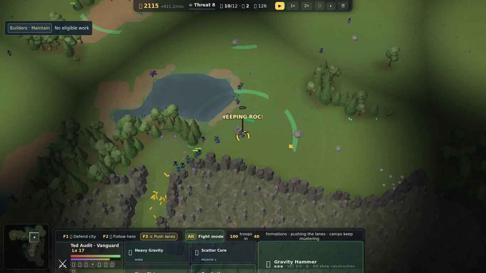
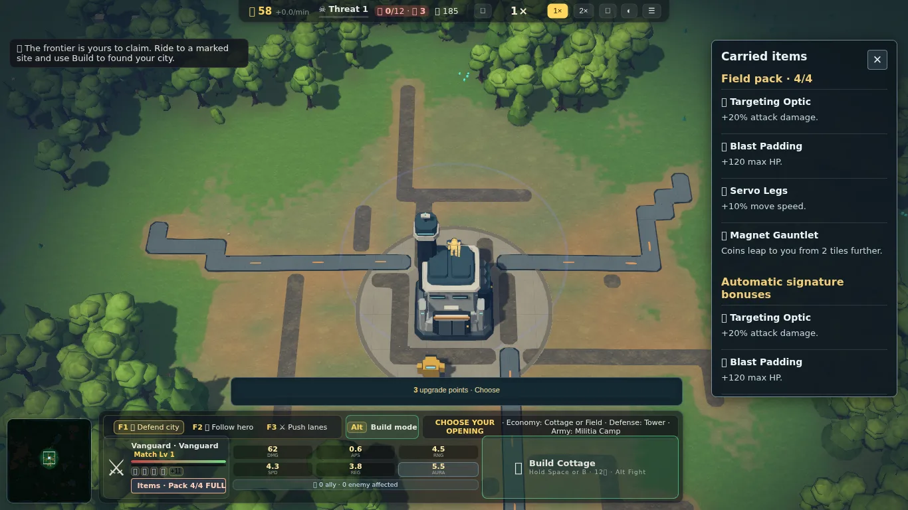
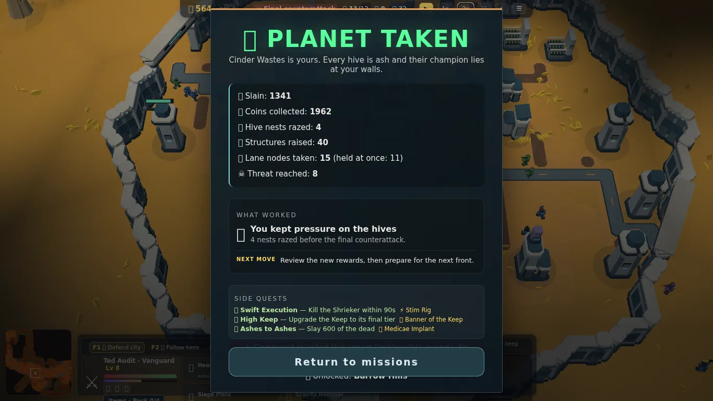
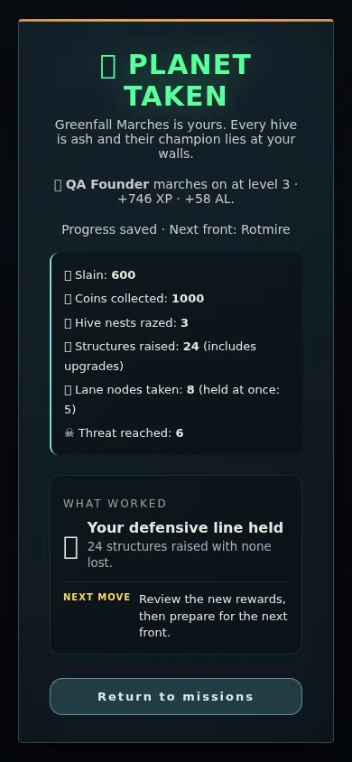
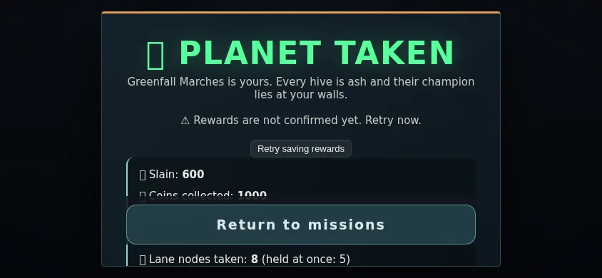
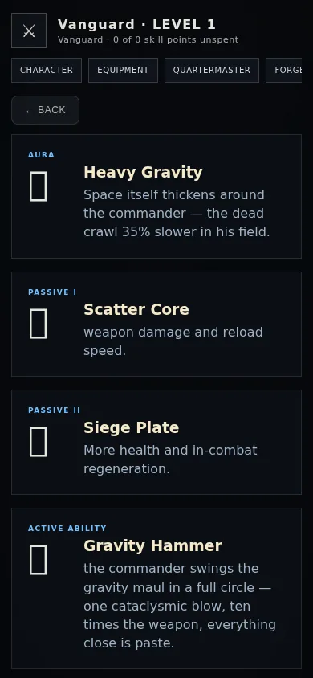
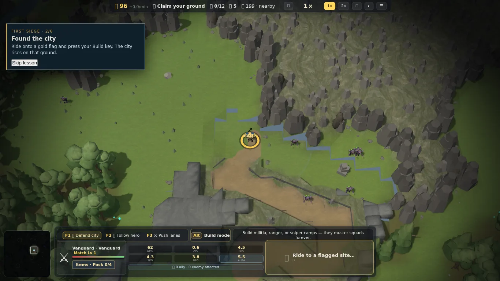

# Campaign reliability and usability — 2026-11-25

Based on merged PR #146 (`4cd46a8`). No deployment, schema migration, combat balance change, historical reward fabrication, or edits to unrelated open PR work.

## Changes

- Keep report limits follow the four configured tiers. Capture validation accounts for retakes over time rather than rejecting every run above 64 captures. Map node count is shared configuration; its value remains 12.
- Pending, rejected and saved rewards are distinct. Unlock/progress confirmation waits for acknowledgement. Transient retry keeps the same account, ticket and request ID; late receipts do not overwrite another match's result UI. Storage failure does not claim the report or offline profile was saved.
- Clicking a held city preserves that mission through setup; locked requests remain locked.
- Pack stays reachable with 15 signatures and four carried items. Signature overflow is compact; upgrade choices expand only on request. Phone ability descriptions fit their cards.
- Keep warnings show health and direction; Locate Keep temporarily pans without rotating movement axes. Enemy directions use allied sight only. Early defeats no longer recommend preparing for a champion that has not arrived.
- Plot roles have different colors and silhouettes. Switchback entrances are labeled before founding and afterward; site descriptions mention ramps. Founding consumes its build press. Builder pause/completion feedback is explicit.
- Hero occlusion silhouette covers buildings as well as terrain, with a depth bias against self-highlighting. Cached building bounds gate the silhouette at 10 Hz; the open-ground fixture submits no silhouette meshes (37 enabled behind the Keep). Coin clusters are consolidated visually, not in the simulation.
- Founder tooltip/ability copy uses founder identity; named companions keep their identity. Match levels, automatic signatures, equipped gear and field loot are distinguished. Lattice origin/available-node labels and first-choice guidance were added.
- PR #146 compatibility: real ability bindings instead of a fictitious W attack, recruitment status instead of “coming soon”, and a compact coach that yields to combat alerts/details.

## Verification

| Check | Result |
|---|---|
| Local production build | `vercel build --prod`: passed; no deployment |
| Full `npm run check` | Passed, including 173 Node tests at that point |
| Final `npm test` | 175 passed, zero failed |
| Final browser shell check | Passed: held/locked mission selection, Pack at three sizes, pending/saved/rejected results, existing guest/lobby/ability behavior |
| Reward contract | 125 assertions passed, including tier 4 accepted/tier 5 rejected, recaptures, storage failure, account isolation and mode-specific rewards |
| PostgreSQL | 61 assertions plus friend-party persistence passed: ticket reuse, atomic rewards/idempotency, concurrency/authorization |
| Live multiplayer smoke | Four disposable accounts: seats 1–4, capacity enforcement, Ready, host authority, cross-account isolation, start/end; cleanup completed |
| Campaign simulation | All five Normal maps reached an ending, no stuck actors, identical snapshot continuation. Greenfall won; four other scripted runs lost. These are not five new UX-playthrough wins. |
| Frontier simulation | Levels 6, 9, 16 ended with no stuck actors. All three scripted runs lost; continuation checks passed where the run reached the checkpoint. No difficulty conclusion. |
| Terrain/determinism | All five authored landforms checked; node-limit extraction retains 12 and simulation determinism passes |
| Rendered UI | Laptop 1366×768, phone 390×844, landscape 844×390: Pack, upgrades, setup, gear, abilities, Lattice, and result states captured; eight map landings and both mountain-map ramp views captured |

### Real signed-in tier-4 victory

A disposable fresh founder completed Greenfall Normal at 2× wall-clock speed in **10:21 game time**, with a tier-4 Keep, 1,286 kills and three hives destroyed. Inputs used normal game commands and paid construction; no fabricated victory/report or modified balances. Rendering was disabled while the automation advanced real-time frames, so this is an integration result, not a human reaction/balance study.

The first result request encountered an injected connection failure. The retry handler resent the same request ID and received HTTP 200. A duplicate submission returned `duplicate: true`, with one game played and one win. Reload retained campaign 1 and founder level 3 / 270 XP. The disposable account was deleted and absence verified. Original traces and full-resolution screenshots are retained in the operator's QA artifacts, not committed with account identifiers or credentials.

### Responsive measurements

With 15 automatic signatures and four field-pack items, native browser clicks opened Pack at each size:

- Laptop: y=715.75, height=23; bottom=738.75 in 768px.
- Phone: y=785.5, height=19; bottom=804.5 in 844px.
- Landscape: y=327.75, height=19; bottom=346.75 in 390px.

Before this fix, the actual playthrough's Pack began at y=777 in a 768px viewport.

## Evidence

Before: actual progressed-character campaign playthrough; Pack clipped below the viewport.

After: deliberately staged maximum-item layout; Pack opened through a browser click. Not a gameplay result.

Before: legitimate Cinder victory rejected, while an unlock was still announced.

After: saved phone and failed landscape states. These two are explicit UI fixtures, not additional server receipts.

Phone ability copy and a scouted ramp entrance. The ramp image positions a fixture hero at the entrance for visual inspection, not a claimed navigation playthrough.

## Review / rollout

Full source diff reviewed, including API validation boundaries, async account/match ownership, HTML escaping, input rearming and presentation-only changes. Existing authenticated ticket ownership, atomic reward grants, request idempotency and fog-of-war remain in place. No new service or schema dependency.

Deploy client and API from the same commit after merge; reverting this PR restores the previous application without a data rollback. Do not automatically replay previously rejected reports or grant historical rewards.

Coverage limits: the live co-op smoke covers room lifecycle, not a fresh two-browser full campaign victory. Survival/labyrinth are covered by existing simulation and reward tests, not fresh end-to-end manual runs. Frontier sampling is automated, not a complete procedural campaign. Missing emoji glyphs in captured images are the headless host's font environment; no icon assets were replaced.
