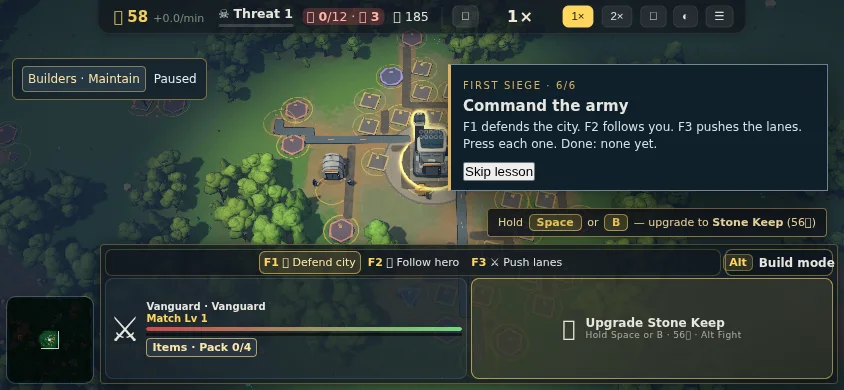
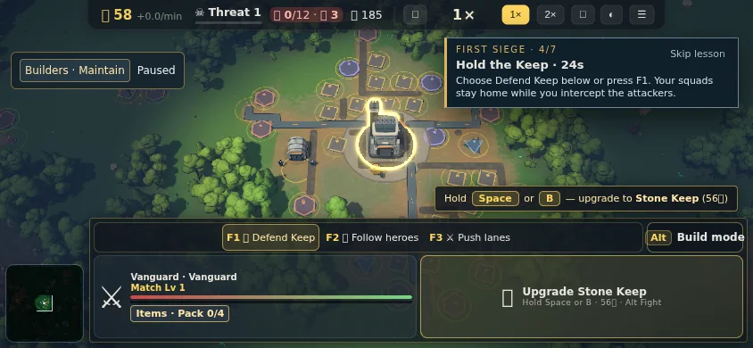
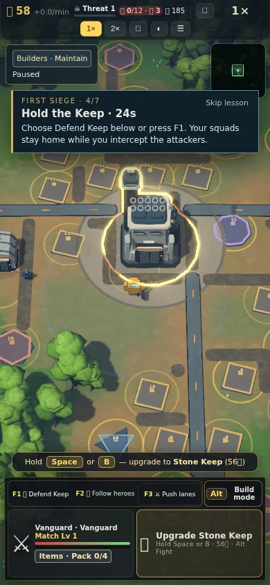
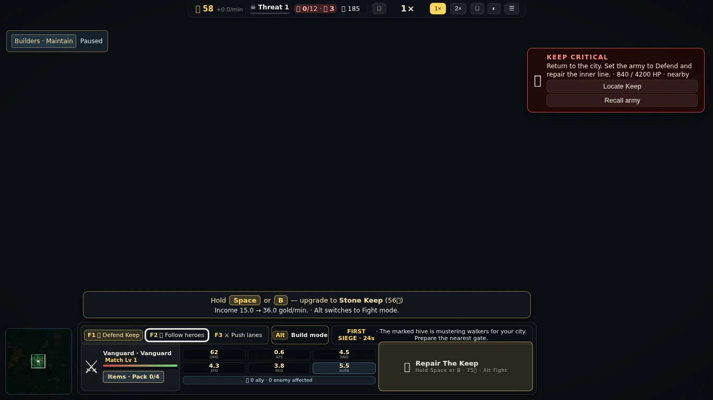
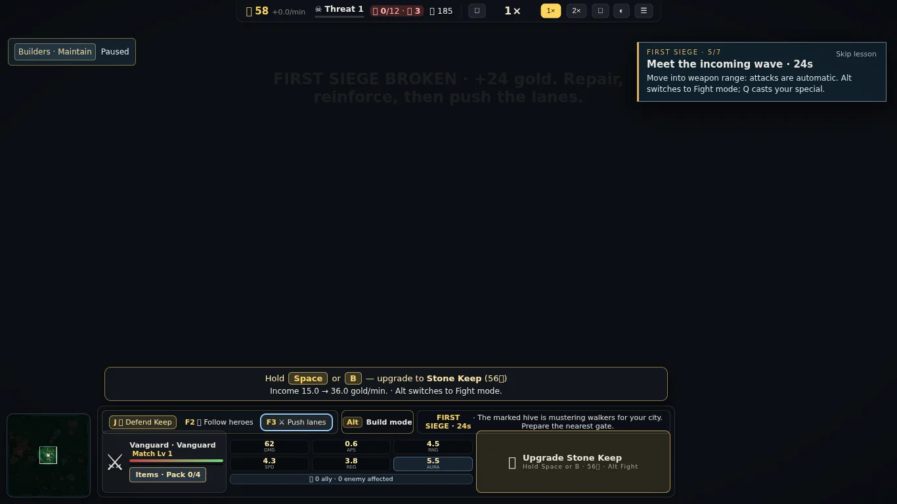
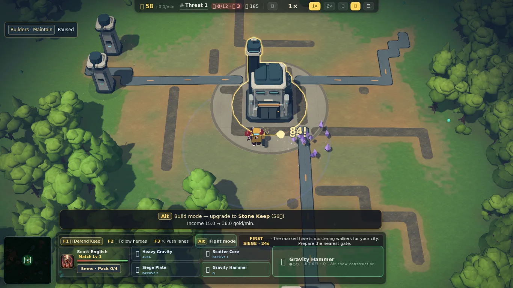

# Opening siege slice — 2026-11-25

Base: PR #147, `97172bef5231170089d7edfe5d36198a32d9174f`.
This is a stacked follow-up, not a merge or production deployment.

## Accepted scope

The first three recommendations: a coherent opening siege, stronger combat
feedback, and easier army commands. Reuses existing first-siege, audio,
particles, coach, and global stance systems. Preserves the choice of colony
site and first build rather than adding a second tutorial mode or a prebuilt
colony. Does not implement the other seven proposals, individual squad micro,
new weapons, a full art overhaul, or new campaign progression.

```text
Choose site -> fund opening -> named hive warning -> defend first wave
  -> existing 24 mission gold -> reinforce -> Push lanes -> continuous siege
```

- Other hive reinforcements and time-driven Threat wait during the opening
  encounter, with a 180-second limit after the first build. The limit persists
  through saves. Existing world enemies still fight; there is no invulnerability.
- The first wave originates at the warned hive, not random forward nodes.
  Its living contacts are gold on the minimap only inside allied vision.
- A skippable coach follows actual actions and the encounter outcome, using
  configured bindings. It no longer orders players to cycle every stance during
  an attack. Phones get the countdown/remaining attackers in the coach too.
- Real command buttons expose pressed state, support native keyboard activation,
  and have larger touch targets. Keep danger offers Recall army. Live HP updates
  preserve button focus. Repeating an active order acknowledges it without
  resetting squad routes. Spectator commands remain blocked.
- Local confirmed hits have short sound cues; critical and heavy-enemy death
  effects are rate-limited and use the existing particle pool. Mute/volume and
  hearing distance remain authoritative. Camera shake is capped and suppressed
  for reduced-motion users. No simulation hit-stop or unseeded sim randomness.
- Opening state and stance participate in the lockstep hash. Room protocol 16
  rejects older rooms. Refresh clients and recreate old rooms when deploying.
  Existing snapshot format remains readable; older opening snapshots receive a
  one-time relief deadline from their saved match time.
- No backend/schema/reward authority changes. The first-wave payout is mission
  gold, not a new client-granted account reward.

## Evidence

- Baseline first-siege regression fails because a surge adds enemies before the
  player chooses an opening. Updated checks pass for isolated reinforcements,
  resumed tracking, reward idempotency, normal siege resumption, and the timeout.
- Browser shell checks exercise the actual HUD callback -> App.issue -> Game.exec
  path, repeat-order completion, spectator read-only behavior, native-button
  activation isolation, focus retention under Keep damage, and rendered audio.
- OfflineAudioContext: normal hit energy 0.099637; critical 0.932; mute 0;
  100 same-frame calls produce the same energy as one call. This proves sound
  generation and burst limits, not subjective audio quality.
- Real local WebRTC between two independent browser contexts: 12 windows and
  120 simulated seconds; guest stance commands travel to the host; both peers
  agree through warning, defense and completion. Guest snapshot restore at 50s
  preserves agreement. This is not a new Supabase/NAT/full-lobby lifecycle test.
- Scripted fresh level-1 Vanguard on real Greenfall terrain: first wave launched
  at 26.87s, defeated at 53.13s with the Keep intact; campaign victory at 6.4
  minutes. The bot used normal commands/paid construction. This is local
  simulation evidence, not a fresh signed-in reward test or human tuning verdict.
- Full campaign regression: all five maps end, no stuck actors, matching restore
  continuation. Greenfall wins; four other scripted runs lose. No claim of five
  balanced or human-playtested maps.
- Laptop 1366x768, phone 390x844, landscape 844x390: actual command clicks and
  Pack bounds checked. Phone command row is 38px; landscape 34px. Landscape
  coach shrinks from 380x127 to 330x79. All five biomes rendered with staged
  hit/death cues; Greenfall checked in High and Low; zero page exceptions.
- Same-machine staged Greenfall frame counters (including postprocessing):
  baseline/candidate High idle 807/807, impact 809/809; Low idle 190/190,
  impact 211/212. These are small-fixture draw calls, not a hardware FPS or
  large-army performance claim. Added rings use the existing particle pool.

### Screenshots

Same Greenfall/site/zoom, showing the corresponding command lesson:

| Before | After |
|---|---|
|  |  |





The following are deliberately staged presentation fixtures, not victory or
kill receipts:




## Limits and next validation

Five uncoached human players have not been recruited or tested. The intended
retention/fun improvement is a hypothesis, not a measured 10x lift. Test whether
new players understand the objective, finish, and voluntarily start another
siege before expanding content. This change does not certify full phone combat,
wide-area networking, or parity with the art north star.

## Release checks

- Full `npm run check`: passed, including 175 Node tests.
- Browser shell and 6,000-tick deterministic replay/restore: passed.
- Local production Vercel build: passed; no deployment performed.
- Local throwaway Postgres authority checks: passed (using the existing bundled runtime libraries).
- Patch hygiene and audio JSON validation: passed.
- CI status is reported on the PR separately.
