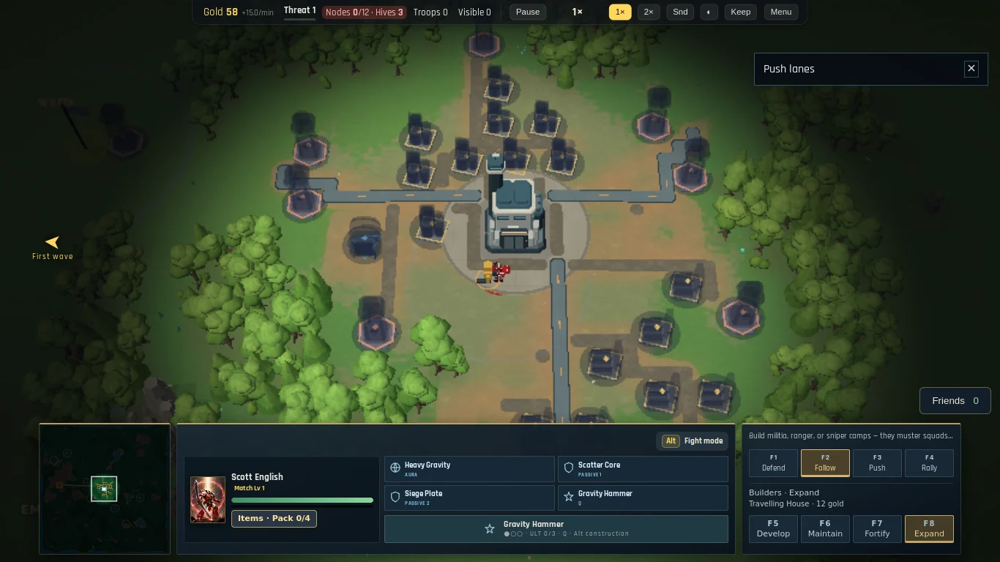
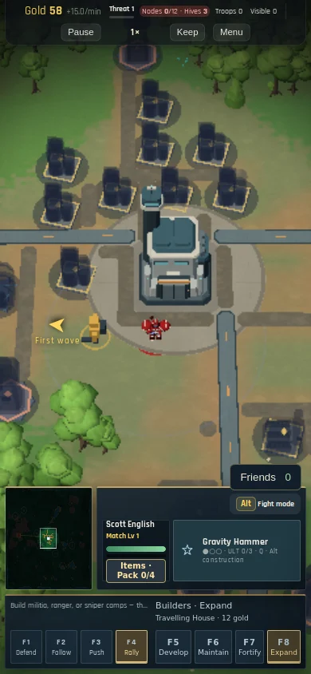
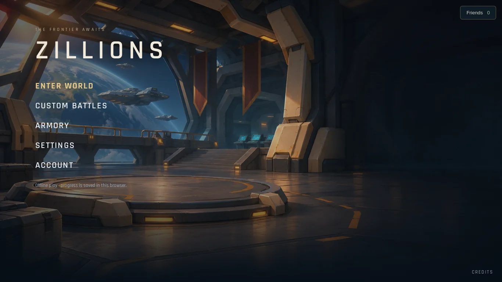
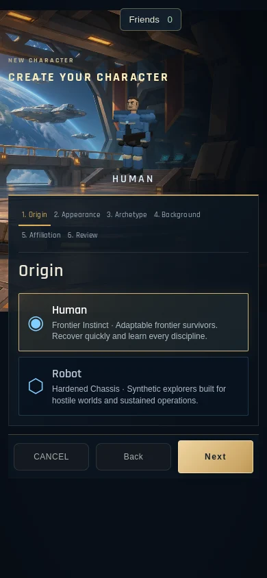
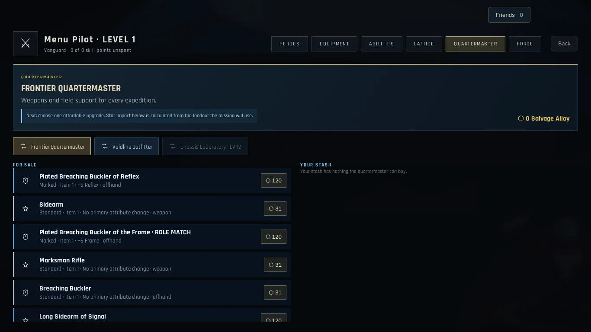
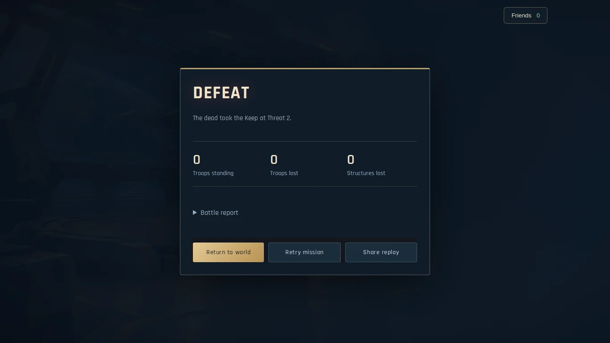
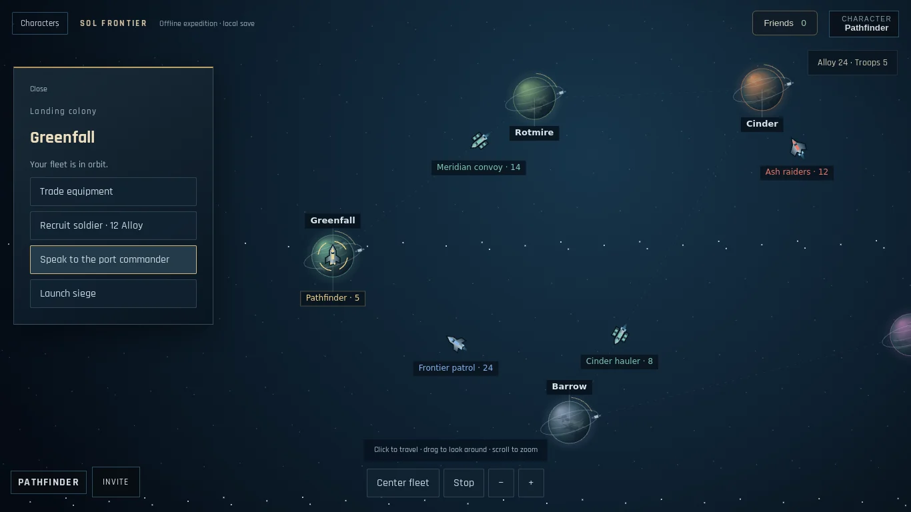
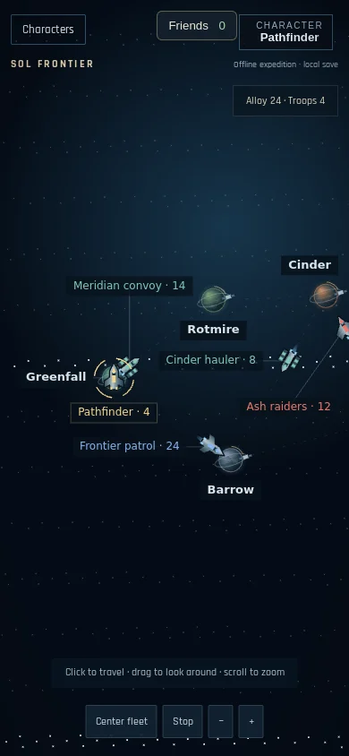

# Playability, menus and shared frontier — review build

This is a local working-branch review, not a production deployment.

## Player-facing scope

- Centered RTS HUD, camera-clickable minimap, readable army/crew orders and
  combat-location indicators; corner-route and exit-cleanup repairs.
- Coherent first-entry, character, inventory, preparation and result screens.
- Shared-space travel and arrival-based services, persistent expedition troops,
  nearby party encounters, tactical battle handoff and survivor return.
- **Parties**, not a separate Co-op mode. The main game follows the shared-world
  / persistent-party model. Custom Battles remains the separate WC3-style
  browser and temporary battle lobby; it does not redefine world-party membership.

## Screenshots

These are actual browser captures. Existing hero models were not upgraded.
The world captures are explicitly offline; they are not multiplayer proof.

### Command deck

### Entry and character creation

### Services and results

### Space travel and colony arrival

## Evidence and limits

The full `npm run check` run passed 333 tests plus its simulation/source checks.
Local Vercel production build passed. Menu review captured 32 screenshots with no
page errors. Real browser checks cover F1–F8, camera/minimap, pause/resume, crew
construction, scene cleanup, world travel/arrival/recruitment/dialogue, and the
battle-return boundary/reload. The latter uses a forced outcome, not a claim of
human playthrough balance.

Real local PostgreSQL checks cover account ownership, receipts, debit/CAS,
party encounter seats, separate tickets/frozen armies and survivor settlement,
alongside 74 existing checks. The rendered party-battle transport fixture and
signed-in release gate are recorded separately in the final PR checklist.

See [authority review](../world-authority-review.md) for capacity and recovery
limits and [delivery contract](../playability-and-shared-world.md) for commands
and migration/rollback instructions. This is not a finished Bannerlord-scale
campaign, political system, assembled-army system, or Dota-quality art release.

## Final integration review

The rendered local party fixture passed: two isolated browsers, explicit Ready
and all-loaded barrier, armies `[5,7]`, matching hashes (3 startup / 23 after
reload), 120 seconds of throttled/lossy-network stress (maximum sampled stall
273 ms), guest reload and stale-invite closure. Reload took 82.5 seconds under
software rendering; this is a correctness check, not a reconnect-speed claim.
It remains separate from the authenticated staging acceptance gate.

Additional real-browser recovery checks caught and fixed three integration
failures: pause Restart could discard encounter context; a transient ticket
outage could reach the destructive broken-save handler; stale world preparation
could prevent Custom Battle hosting. The final probe verifies hidden/guarded
restart, byte-for-byte save retention with zero cloud clears on ticket failure,
and independent Custom Battle launch.
