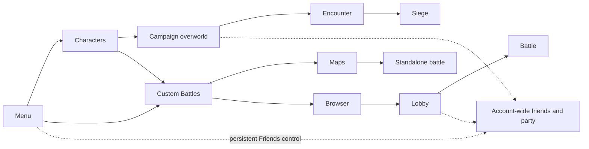

# Social and custom-battle navigation

Alex approved this layout on 2026-11-26. It supersedes the earlier suggestion
that friends should be buried in Account.

- Title navigation: Enter World, Custom Battles, Armory, Settings, Account.
- Character selection: Enter World is primary; Custom Battles immediately below.
- Friends is a persistent independent panel, not a menu destination or an
  Account subsection. Friendships use the existing account-owned database rows.
- Online friends first; friend requests, accept/remove, party invites and room
  invites use existing services. Offline invitations are disabled. Private
  messaging and detailed character/location presence are not implemented.
- The panel shows the caller's actual persistent party. Manage opens existing
  create/join/leave/leadership controls. A party invitation does not automatically
  join a battle, change character or change political affiliation.
- Custom Battles uses the existing SC2/WC3-style room browser, map selection,
  public/private creation, player seats, chat and explicit Ready/Start barrier.
  Custom lobby seats/chat appear beside settings on laptop and first on phone.
  Teams beyond the cooperative side and AI slots remain disabled.
- Campaign setup shows only the selected encounter; arbitrary map selection
  belongs to Custom Battles. The current campaign remains a site selector,
  not the unbuilt persistent shared-world simulation.
- Standalone custom battles do not request reward tickets, change account or
  guest campaign progression, or overwrite the campaign save. Their result
  returns to Custom Battles. Battle-room teardown still ends the room; keeping
  the exact same room alive for rematches is not implemented in this increment.

## Scope review

The chosen approach reuses friendships, presence, friend parties and rooms.
A label-only change would leave friends inaccessible outside the old route.
A replacement social backend would add migration/authorization risk without
benefit. Keep the existing services and change their presentation/entry points.

Architecture: one independent native dialog, existing room lifecycle retained.
Errors: disconnected/loading/empty friends, failed invite and failed party RPC
are visible; no fabricated friends or successful-delivery claims.
Security: account handles only; existing RPC/RLS membership checks stay in force.
Interactions: Escape, focus return, menu/held-input isolation, logout clearing,
request concurrency and temporary-channel cleanup require checks.
Code: reuse existing UI IDs and data adapters; avoid duplicate friend stores.
Tests: UI journeys plus reward/invite behavioral regressions and co-op gates.
Observability: local reports and browser errors; no new monitoring service.
Database: no migrations or reward-authority writes.
API: existing party RPCs and friend rows; invite broadcast carries party code.
Performance: online presence heartbeat; bounded party refresh while panel open.
Design: desktop and phone screenshots for menu, roster, browser, maps, creation,
encounter, guest/loaded social states. Populated QA fixtures are labeled as such.
